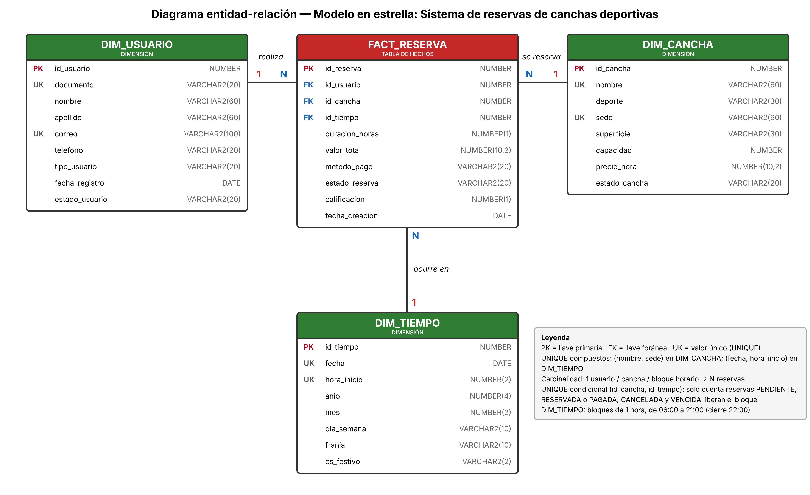

# Action Sport Club · Centro de reservas y consultas

Aplicación web para gestionar las reservas de canchas de **Action Sport Club** (sedes El Escobero y San Lucas) y responder preguntas de negocio con SQL, sin escribir código.

**Stack:** Oracle Autonomous Database · Python (`oracledb`) · Streamlit · scikit-learn



---

## Funcionalidades

| Módulo | Qué hace |
|---|---|
| **Panel del club** | Indicadores del día, solicitudes activas, canchas más solicitadas y estado de las canchas por sede |
| **Solicitar cancha** | Ofrece solo horarios libres (sin cruces, también en reservas de 2 y 3 horas) |
| **Registrar usuario** | Alta con validaciones; el usuario puede reservar de inmediato |
| **Reservas por estado** | Ciclo de vida `PENDIENTE → RESERVADA → PAGADA`, vencimiento automático y calificación |
| **Canchas** | Estado y precio; aviso de reservas afectadas por mantenimiento |
| **Consultas guiadas** | 18 preguntas de negocio con filtros, gráfica, SQL visible y descarga a Excel |
| **Análisis** | Tablero descriptivo: demanda, mapa de calor de horas pico, ingresos y calidad |
| **Segmentación** | K-means con silueta y reglas SQL para dirigir promociones |
| **Consultas SQL** | Modo experto de solo lectura |

## Principios del backend

- **Sin descargas masivas:** cada sección ejecuta solo el SQL que necesita; Oracle agrupa y Python recibe el resumen (tope de 2.000 filas por consulta).
- **Consultas con parámetros** (`:nombre`) para evitar inyección de SQL.
- **Transacciones:** toda escritura hace `COMMIT` completo o `ROLLBACK`.
- **Usuario de mínimo privilegio:** la app se conecta como `APP_RESERVAS`, sin `DELETE` ni DDL.
- **Integridad en la base de datos** (CHECK, UNIQUE, FK) y **reglas de negocio en la app**.

## Estructura del repositorio

```
├── app.py                        # Aplicación Streamlit
├── probar_conexion.py            # Prueba rápida de conexión a Oracle
├── requirements.txt
├── .streamlit/
│   ├── config.toml               # Tema con la paleta del club
│   └── secrets.toml.example      # Plantilla de credenciales (copiar como secrets.toml)
├── sql/
│   ├── 00_USUARIOS.sql           # Usuarios RESERVAS y APP_RESERVAS (como ADMIN)
│   ├── 01_DDL.sql                # Tablas, constraints, índices y permisos
│   └── 02_DML.sql                # Datos de prueba y sincronización de IDENTITY
├── assets/                       # Logo opcional (logo.png)
└── docs/
    ├── diagrama_er.png
    ├── GUIA_USUARIO.md
    ├── ActionSportClub_Constraints_Reglas.docx
    └── ActionSportClub_Presentacion.pptx
```

## Instalación

### 1. Base de datos (Oracle Autonomous Database)
1. Como **ADMIN**, ejecuta `sql/00_USUARIOS.sql` (cambia las contraseñas antes).
2. Como **RESERVAS**, conectado al servicio `*_tp`, ejecuta `sql/01_DDL.sql` y luego `sql/02_DML.sql` (F5 en SQL Developer).
3. Verifica: 80 usuarios, 15 canchas, 3.856 bloques y 665 reservas.

### 2. Aplicación
```bash
pip install -r requirements.txt
cp .streamlit/secrets.toml.example .streamlit/secrets.toml   # y completa tus datos
python probar_conexion.py
python -m streamlit run app.py
```

Requiere Python 3.11 o superior. En Windows (modo thick), edita el `sqlnet.ora` del wallet y reemplaza `?/network/admin` por la carpeta del wallet.

### 3. Publicar en Streamlit Community Cloud
1. Sube este repositorio a GitHub (las credenciales y el wallet están en `.gitignore`).
2. En [share.streamlit.io](https://share.streamlit.io), crea una app con `app.py`.
3. En **Advanced settings → Secrets**, pega la *Opción C* de `secrets.toml.example`: contenido de `ewallet.pem`, `tnsnames.ora` y la clave del wallet.

## Documentación

- [Guía de usuario](docs/GUIA_USUARIO.md)
- Constraints y reglas de negocio: `docs/ActionSportClub_Constraints_Reglas.docx`
- Presentación para gerencia: `docs/ActionSportClub_Presentacion.pptx`

## Autores

Juan Esteban Londoño · Manuela Gutiérrez — Proyecto académico de Business Intelligence.

> Datos de prueba: usuarios ficticios; sedes y deportes reales del club; precios de referencia.
